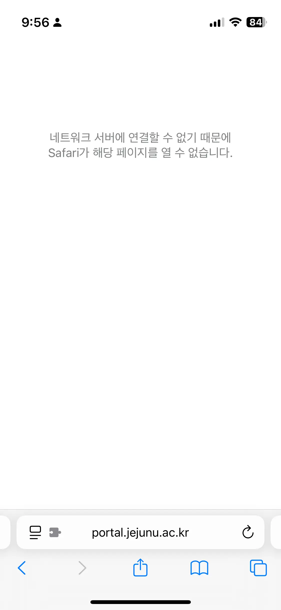
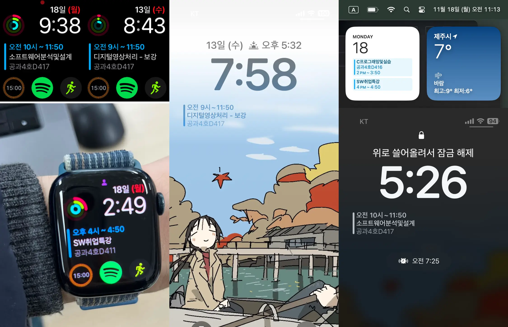

📅 A web automation project that refreshes Jeju National University lecture schedule data daily and serves it as an iCalendar server for subscription in native calendar clients (Google Calendar, Apple Calendar, etc.).

|                                                                 [Converter Spec](src/tests/index.test.ts) Coverage                                                                  |                                                                                AWS S3 Upload Status                                                                                 |
| :---------------------------------------------------------------------------------------------------------------------------------------------------------------------------------: | :---------------------------------------------------------------------------------------------------------------------------------------------------------------------------------: |
|  |  |

## Motivation

Last semester(2024 Spring), while checking frequent schedule changes (substitute classes for holidays, cancellations due to professors' personal circumstances, etc.) through the Jeju National University portal web service, I repeatedly experienced the following inconveniences:

1. The portal service has significantly poor **loading experience** and **responsiveness**.
   - **Web service login delay**: Due to non-essential internal logic during the login process, there is an unnecessary delay of about 3 seconds. As a workaround, I personally wrote and use a [userscript that directly performs only the SSO request](https://github.com/mu-hun/jejunu-sw/blob/e190950/portal.user.js#L21-L23).
     - This is a technical issue unrelated to Apple [Private Relay] activation mentioned below.
   - **Unstable app service**: After launching the app, if you briefly switch to another task or return to the app after a few minutes, only a white screen is displayed. In this case, you must force quit and relaunch the app to use it. [Reproduction video attached](https://youtube.com/shorts/qfZ4gfhK5WA)
2. iOS environment constraints: When [Private Relay] is enabled on iOS, the request delay for portal web and app services becomes unbearably long, forcing primary use of desktop environments.
3. iOS Safari compatibility (resolved): The portal login page frequently failed to load on iPhone.

   

[Private Relay]: https://support.apple.com/en-us/102602

To solve these problems, I built an HTTP GET server pipeline that refreshes lecture schedule data daily, converts it to `.ics` files in [iCalendar standard](https://icalendar.org/) format, and supports subscription in external calendar clients (Google Calendar, Apple Calendar, etc.).

I now enjoy a more convenient experience of checking schedule changes directly on my devices.

## Test-Driven Implementation

I [classified the lecture schedule data schema](src/response.ts#L44) from the Jeju National University portal, including various cases such as cancellations, supplements, and consecutive lectures, and prepared a [reconstructed lecture format] for easier identification during development. I prepared appropriate input data for each case and defined expected outputs for use in testing.

[reconstructed lecture format]: src/reconsturct.d.ts#L8_L41

Based on the reconstructed lecture format, I first wrote unit tests, then implemented utilities for converting to iCalendar format, and verified the accuracy of the conversion process through integration tests.

1. Unit test case preparation
   - Created a [unit test case set](src/tests/testcases.json) reflecting various lecture schedule situations (cancellations, supplements, etc.).
2. Unit test specification writing
   - Based on the prepared test case inputs, wrote [test specifications](src/tests/index.test.ts#L17-L77), with utility implementation in [`src/iCalConverter.ts`](src/iCalConverter.ts).
     - [#L3-L21](src/iCalConverter.ts#L40-L59): Utility to distinguish normal lectures, cancellations, supplements, and consecutive lectures from portal lecture schedule data
     - [#L40-L59](src/iCalConverter.ts#L40-L59): Utility to convert portal lecture schedule data to [reconstructed lecture format]
     - [#L61-L82](src/iCalConverter.ts#L61-L82): Utility to merge consecutive lecture schedules into one
     - [#L84-L95](src/iCalConverter.ts#L84-L95): Utility to convert reconstructed data to iCalendar event format
3. Integration test dump data and expected output file preparation
   - Prepared [sample dump data] and expected output [`.ics` file](src/tests/excepted.ics), and verified the entire conversion process through [integration tests](src/tests/index.test.ts#L79-L86).

[sample dump data]: src/tests/response.json

## Maintenance Reference

### Fetching Schedule Data from Jeju National University Portal

- GET https://portal.jejunu.ac.kr/api/patis/timeTable.jsp
- Query params: `sttLsnYmd`, `endLsnYmd` in `YYYYMMDD` format

> Example: https://portal.jejunu.ac.kr/api/patis/timeTable.jsp?sttLsnYmd=20240902&endLsnYmd=20241221

Portal login is required before making this HTTP GET request.

### Response Example

Please refer to the [sample dump data].
